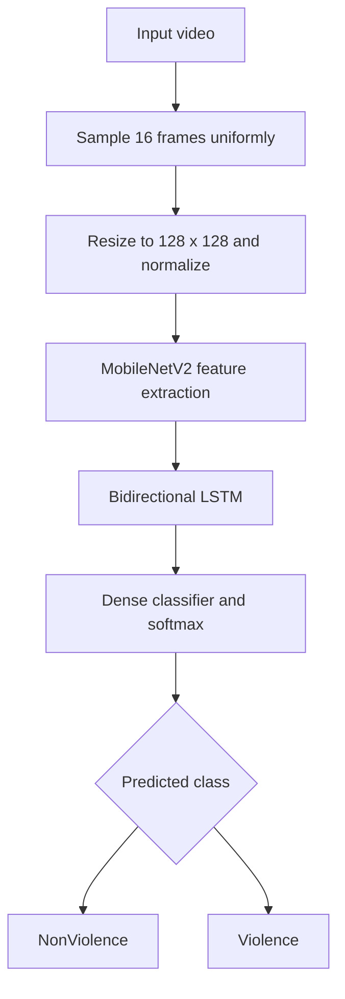

# Intelligent Video-Based Violence Detection

A research and graduation project that classifies an uploaded video as **Violence** or **NonViolence** using a hybrid **MobileNetV2 + Bidirectional LSTM** deep-learning model.

> **Research prototype:** the application makes one video-level prediction from 16 uniformly sampled frames. It is not a real-time, frame-by-frame detector and must not be used as the sole basis for consequential decisions.

## Features

- MobileNetV2 extracts visual features from video frames.
- Bidirectional LSTM learns temporal patterns across the sampled frames.
- OpenCV handles video decoding, preprocessing, and annotated-video generation.
- A local Gradio interface lets users upload a video and inspect the result.
- The trained model is included in `models/violence_model.h5`.
- The training workflow is provided as a Jupyter notebook.

## Architecture



## Quick start

**Recommended:** Python 3.10–3.12. The trained model is already included; the dataset is not.

```bash
# Clone the repository
git clone <YOUR_REPOSITORY_URL>
cd Intelligent-Video-Violence-Detection

# Create and activate a virtual environment
python -m venv .venv
```

Windows PowerShell:

```powershell
.venv\Scripts\Activate.ps1
```

macOS / Linux:

```bash
source .venv/bin/activate
```

Install the application dependencies and run it:

```bash
python -m pip install --upgrade pip
pip install -r requirements.txt
python app.py
```

Open `http://127.0.0.1:7860` in your browser. The app runs locally by default; public Gradio sharing is disabled unless explicitly enabled with `GRADIO_SHARE=true`.

## Training

The training workflow is in [`notebooks/01_train_model.ipynb`](notebooks/01_train_model.ipynb). To install its additional dependencies:

```bash
pip install -r requirements-train.txt
```

The notebook downloads the **Real-Life Violence Situations (RLVS)** dataset through the Kaggle API. The dataset and Kaggle credentials are not included in this repository. Configure your Kaggle API credentials in your local/Colab environment; never commit `kaggle.json` or the dataset.

The notebook saves the trained model under `workdir/violence_model.h5`. To use a newly trained model with the app, copy it to `models/violence_model.h5` (replacing the supplied checkpoint after keeping a backup).

## Model details and reported result

| Item | Value |
|---|---|
| Classes | `NonViolence`, `Violence` |
| Frames per video | 16, sampled uniformly |
| Frame size | 128 × 128 RGB |
| Preprocessing | Pixel values scaled to [-1, 1] |
| Feature extractor | MobileNetV2 |
| Temporal model | Bidirectional LSTM (128 units) |
| Audio | Not used |

The training notebook recorded a **maximum validation accuracy of 94.99%**. Its classification report contains 399 processed clips out of 400 validation clips because one clip was skipped during preprocessing. This is a notebook-reported validation result, not an independently verified benchmark. Re-evaluate with an independent, group-aware test split before making strong performance claims.

## Repository structure

```text
.
├── app.py
├── models/
│   └── violence_model.h5
├── notebooks/
│   └── 01_train_model.ipynb
├── tests/
│   └── test_video_processing.py
├── .gitignore
├── requirements.txt
├── requirements-train.txt
└── requirements-dev.txt
```

Run the lightweight tests with:

```bash
pip install -r requirements-dev.txt
python -m pytest -q
```

## Limitations

- The model predicts one label for the entire clip from 16 sampled frames; it does not identify when or where an incident occurs.
- The annotated output repeats the video-level label across the video. It is not a frame-by-frame detection timeline.
- Audio is not analyzed, and the generated annotated video does not preserve the original audio track.
- Confidence scores are not calibrated probabilities of a real-world incident.
- The dataset may not represent all environments, camera angles, or definitions of violence.
- Use this project for educational and research experimentation with human review. Do not use it as the sole basis for security, law-enforcement, employment, disciplinary, or other consequential decisions.

## Reference

The following Kaggle notebook was consulted as a **technical reference** for the general use of MobileNetV2 and Bidirectional LSTM in video-based violence classification. It is not the source repository for this project, and its code or reported results should not be attributed to this implementation.

- [Real Time Violence Detection | MobileNet Bi-LSTM — Kaggle](https://www.kaggle.com/code/abduulrahmankhalid/real-time-violence-detection-mobilenet-bi-lstm/notebook)
